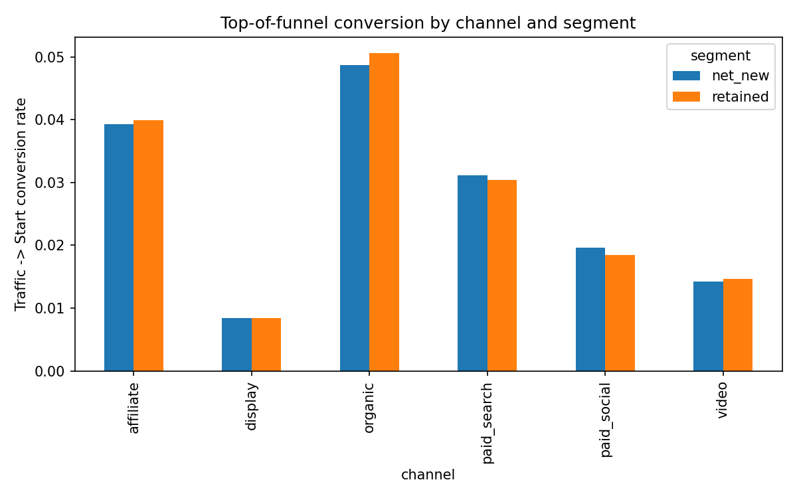
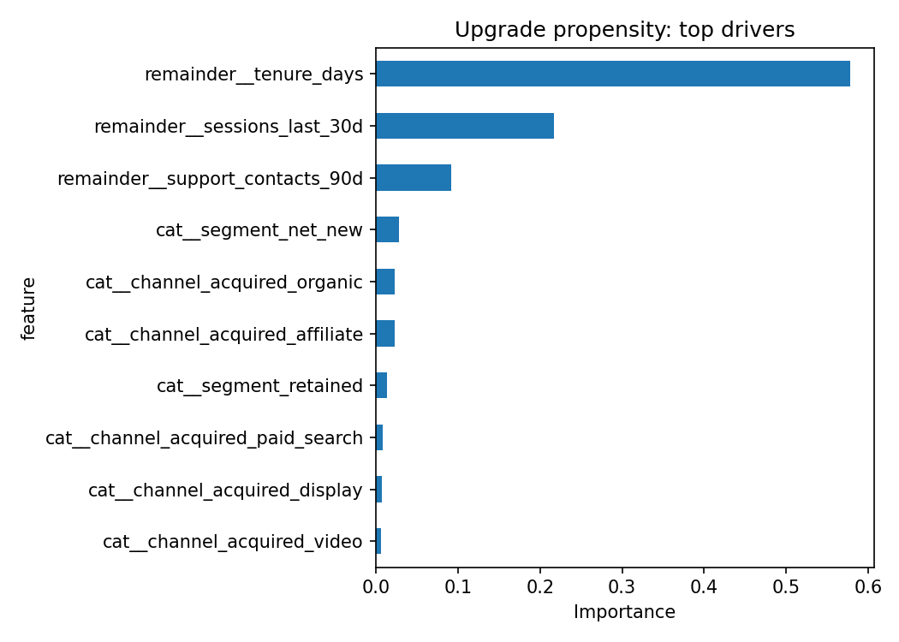

# GTM Funnel Analytics + Claude Self-Serve Agent

A portfolio project pairing growth/GTM data science (funnel analysis, A/B-style causal inference, propensity modeling) with a Claude-powered natural-language agent that lets a non-technical stakeholder query the results in plain English.

It's built to mirror the shape of real freemium-SaaS growth work — top-of-funnel channel measurement, a difference-in-differences read on a product experiment, and a lifecycle propensity model — the same toolkit used to run acquisition and upsell measurement programs, plus a self-serve GenAI layer on top so non-technical stakeholders can query results without waiting on a data pull.

**All data here is synthetic**, generated by `01_generate_data.py` from a seeded random process. No employer or proprietary data is used anywhere in this repo — it exists purely to demonstrate the methodology end to end.

## What it demonstrates

- **Funnel / GTM analytics** — traffic → signup → activation conversion by paid channel and customer segment (`02_funnel_and_did_analysis.py`, part A)
- **Causal inference** — a difference-in-differences regression evaluating whether a redesigned upsell flow actually moved conversion, versus just looking at a before/after average (`02_funnel_and_did_analysis.py`, part B)
- **Predictive modeling** — a gradient-boosted upgrade-propensity model with evaluation metrics and a ranked outreach list (`03_upgrade_propensity_model.py`)
- **Applied GenAI / LLM engineering** — a Claude tool-use agent that answers natural-language questions by calling the analytics functions above, so every answer is grounded in a real computed number instead of a guess (`04_llm_agent.py`)

## Project layout

```
01_generate_data.py            synthetic data generator
02_funnel_and_did_analysis.py  channel funnel + DiD experiment analysis
03_upgrade_propensity_model.py gradient boosting propensity model
04_llm_agent.py                Claude tool-use natural-language agent
data/                          generated input CSVs
output/                        generated charts, models, and result files
```

## Running it

```bash
pip install -r requirements.txt

python 01_generate_data.py
python 02_funnel_and_did_analysis.py
python 03_upgrade_propensity_model.py

export ANTHROPIC_API_KEY=sk-ant-...
python 04_llm_agent.py "Which paid channel converts best for new customers?"
python 04_llm_agent.py "Did the upsell redesign actually work?"
python 04_llm_agent.py "Who are the top 5 customers to target for an upgrade push?"
```

Or run `python 04_llm_agent.py` with no arguments for an interactive prompt.

## Results

### A) Channel funnel performance

Traffic → signup → activation, by paid channel and segment (top 5 of 12 channel/segment combinations, full table in `output/channel_funnel_summary.csv`):

| Channel | Segment | Traffic | Signups | Starts | Traffic→Signup | Signup→Start | **Traffic→Start** |
|---|---|---:|---:|---:|---:|---:|---:|
| organic | retained | 54,519 | 3,928 | 2,756 | 7.2% | 70.2% | **5.1%** |
| organic | net_new | 95,840 | 6,782 | 4,668 | 7.1% | 68.8% | **4.9%** |
| affiliate | retained | 26,525 | 1,580 | 1,059 | 6.0% | 67.0% | **4.0%** |
| affiliate | net_new | 48,880 | 2,908 | 1,919 | 6.0% | 66.0% | **3.9%** |
| paid_search | net_new | 147,606 | 7,595 | 4,590 | 5.2% | 60.4% | **3.1%** |
| display | net_new | 189,398 | 3,410 | 1,584 | 1.8% | 46.5% | **0.8%** |

Organic and affiliate convert 5-6x better end-to-end than display despite display driving the most raw traffic — the kind of gap that should shift budget, not just get reported on.



### B) Difference-in-differences: did the upsell redesign work?

Raw group means alone are misleading — the treatment group jumped from 8.8% to 13.6%, but the control group also drifted slightly (8.7% → 8.9%) over the same window from seasonality alone:

| Group | Pre-launch | Post-launch | Raw change |
|---|---:|---:|---:|
| Control | 8.66% | 8.87% | +0.21pt |
| Treatment | 8.83% | 13.57% | +4.74pt |

Netting out the control group's own trend via a DiD regression (robust standard errors) isolates the causal effect:

| Term | Coefficient | Std. Err | p-value |
|---|---:|---:|---:|
| **treated × post (the DiD estimate)** | **+4.51pt** | 0.008 | **< 0.001** |
| treated (pre-period difference) | +0.17pt | 0.005 | 0.743 (n.s.) |
| post (control group's own trend) | +0.21pt | 0.005 | 0.670 (n.s.) |

**Takeaway:** the redesign caused a statistically significant +4.5-point lift in free→premium conversion (p < 0.001) — close to, but meaningfully different from, the naive +4.74pt raw comparison, because the regression correctly nets out the ~0.2pt of drift that would have happened anyway. Full regression output in `output/did_regression_summary.txt`.

### C) Upgrade-propensity model

Gradient-boosted classifier predicting which free customers are most likely to upgrade, for outreach prioritization:

| Metric | Value |
|---|---:|
| Test AUC | **0.682** |
| Precision (upgraders) | 0.60 |
| Recall (upgraders) | 0.49 |
| Accuracy | 0.64 |



Tenure and 30-day session activity dominate the model — together they account for ~80% of predictive weight, ahead of acquisition channel or segment. The scored, ranked list of the top 500 customers to target is in `output/top_upgrade_candidates.csv`; the top-ranked customer has a 92.3% predicted upgrade probability.

### D) Ask it in plain English

The Claude agent (`04_llm_agent.py`) answers questions like *"Did the upsell redesign actually work?"* by calling the `get_did_result()` tool above and reporting the real regression coefficient and p-value back — not a hallucinated estimate.

## Why this project

Built as a hands-on demonstration of the intersection of causal inference, predictive modeling, and applied GenAI/LLM engineering — using Claude Code as the primary build tool, the same way Claude Code and Cursor are used for day-to-day agentic development work.
