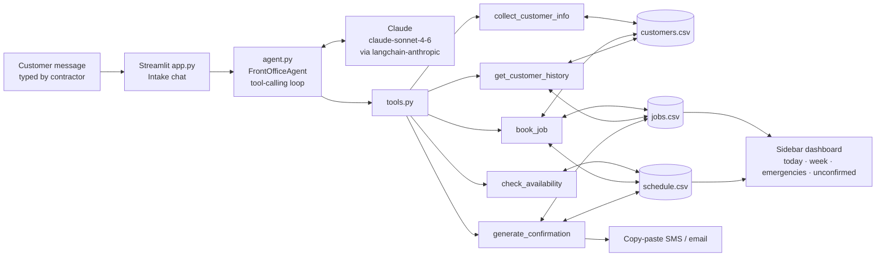

# Contractor Front Office Agent

A virtual receptionist for one-person and small-team home services businesses — plumbers, roofers, electricians, HVAC techs, handypeople.

When a customer calls or messages, the contractor opens the agent and lets it run the front office conversation: it collects the customer's details, checks the schedule, books the job, flags emergencies and repeat clients, and writes a confirmation text ready to paste into an SMS or email. No notepad, no "I'll call you back", no forgotten details.

Built with **Claude (via LangChain)**, **pandas** and **Streamlit**. Data lives in plain CSV files.

## Features

- **Conversational intake**: asks one question at a time (name → phone → address → urgency → slot)
- **Returning customer recognition**: looks up by phone or name, greets by name, references past jobs, flags **VIP** clients (3+ jobs)
- **Availability**: offers 3 real open slots from `schedule.csv`; emergencies get the very next openings
- **Booking**: writes the job to `jobs.csv`, marks the slot booked, updates customer history, and auto-flags crew/materials needs
- **Confirmation**: generates a plain-English SMS and email with a one-click copy box
- **Contractor dashboard** (sidebar): today's jobs, this week's schedule, emergency jobs, unconfirmed bookings

## Architecture



| File | Role |
|---|---|
| `app.py` | Streamlit UI — intake chat (main) and contractor dashboard (sidebar) |
| `agent.py` | System prompt + loop: Claude decides which tool to call, results are fed back until it replies |
| `tools.py` | The 5 LangChain tools; all business logic lives here |
| `data_store.py` | CSV load/save, ID generation, phone normalization |
| `seed_data.py` | Generates sample data relative to today |
| `data/*.csv` | Schedule, jobs, customers |

### The 5 tools

| Tool | What it does |
|---|---|
| `collect_customer_info(name, phone, address, email)` | Finds an existing customer (phone first, then name) or creates a new one |
| `check_availability(urgency, preferred_date)` | Returns 3 open future slots; emergencies get the earliest |
| `book_job(customer_id, slot_id, job_type, description, urgency, materials_or_crew_notes)` | Creates the job, books the slot, bumps the customer's job count, adds emergency/VIP/crew flags |
| `get_customer_history(phone_or_name)` | Past jobs + VIP flag (3+ jobs) |
| `generate_confirmation(job_id)` | Ready-to-send SMS and email text |

Jobs are saved with status `pending_confirmation`. Once you've actually sent the text, click **Mark confirmation sent** (in the chat or the dashboard) to set it to `confirmed`.

## How to run

Requires Python 3.10+ and an [Anthropic API key](https://console.anthropic.com/).

```bash
git clone https://github.com/KrishAK47/contractor-front-office-agent.git
cd contractor-front-office-agent
python -m venv .venv
source .venv/bin/activate        # Windows: .venv\Scripts\activate
pip install -r requirements.txt
cp .env.example .env             # then add your ANTHROPIC_API_KEY
streamlit run app.py
```

`.env` settings:

| Variable | Default | Purpose |
|---|---|---|
| `ANTHROPIC_API_KEY` | — | Required |
| `CLAUDE_MODEL` | `claude-sonnet-4-6` | Any Claude model ID |
| `BUSINESS_NAME` | `our team` | Used in the email confirmation |
| `BUSINESS_PHONE` | `[your number]` | Used in the SMS/email confirmation |

**Sample data**: if the schedule is missing or entirely in the past, the app regenerates it starting today. To reset everything manually: `python seed_data.py --reset` (or the **Reset sample data** button in the sidebar).

Try a returning VIP customer by giving the name **Maria Lopez** / phone **416-555-0198**.

## Example conversation

```
Customer: Hi I have a leaking pipe under my kitchen sink
Agent:    I can help you get that booked in. Can I get your name?
Customer: John Smith
Agent:    Thanks John! And the best phone number to reach you?
Customer: 647-555-1234
Agent:    Welcome — looks like this is your first time with us. What's the address for the job?
Customer: 123 Main Street, Toronto
Agent:    Got it. Is there an email you'd like the confirmation sent to? (optional)
Customer: no
Agent:    No problem. How urgent is this — is it actively leaking right now?
Customer: Yes water is dripping
Agent:    **EMERGENCY** — marking this as urgent and prioritizing you.
          I have today at 2:00pm, today at 4:00pm, or tomorrow at 9:00am.
          Which works best?
Customer: 2pm today
Agent:    Let me confirm: John Smith, 123 Main Street, Toronto, 647-555-1234 —
          plumbing leak under the kitchen sink, today (Tue Oct 13) at 2:00pm.
          Shall I book it?
Customer: yes
Agent:    You're booked! Here's the confirmation text to send:

          > Hi John, your plumbing leak appointment is confirmed for today
          > (Tue Oct 13) at 2:00pm at 123 Main Street, Toronto. Our tech will
          > call 30 mins before arrival. Questions? Call us at 416-555-0100.

          Flagged: EMERGENCY.
```

The job then appears in `data/jobs.csv`, the slot flips to `booked` in `data/schedule.csv`, and the sidebar shows it under **Today's jobs** and **Emergency jobs**.

## Extending to other trade types

The agent isn't hard-coded to any trade — `job_type` is free text Claude fills in from the conversation. To tailor it:

1. **Tell the agent what you do.** Edit the `Context` section of `OPERATING_RULES` in `agent.py` (e.g. "The business handles landscaping, snow removal and fencing").
2. **Define what counts as an emergency** for your trade in step 4 of `OPERATING_RULES` (e.g. "a tree on a roof", "a lockout", "no hot water").
3. **Add crew/materials rules** to `CREW_HINTS` in `tools.py` — keys are matched against the job type and description:
   ```python
   CREW_HINTS = {
       "fence": "Materials: bring post-hole digger + concrete",
       "tree removal": "Crew needed: 3-person crew + chipper",
   }
   ```
4. **Change slot length or hours** in `seed_data.py` (`SLOT_TIMES`, `SLOT_HOURS`, `WORKDAYS`), or edit `data/schedule.csv` directly — e.g. 4-hour slots for roofing, 1-hour slots for handyman calls.
5. **Customize the confirmation wording** in `generate_confirmation` in `tools.py` (add a deposit note, parking instructions, a review link, etc.).
6. **Add new tools** (e.g. `quote_estimate`, `cancel_job`) by writing a `@tool` function in `tools.py` and adding it to `ALL_TOOLS` — the agent picks it up automatically.

## Limitations

- Single-user local app — CSV files aren't safe for concurrent writes.
- The contractor types the customer's side; there's no live SMS/phone integration (yet). Twilio would be a natural next step.
