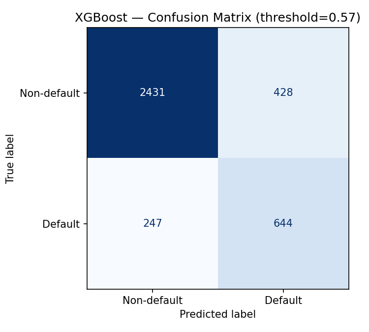
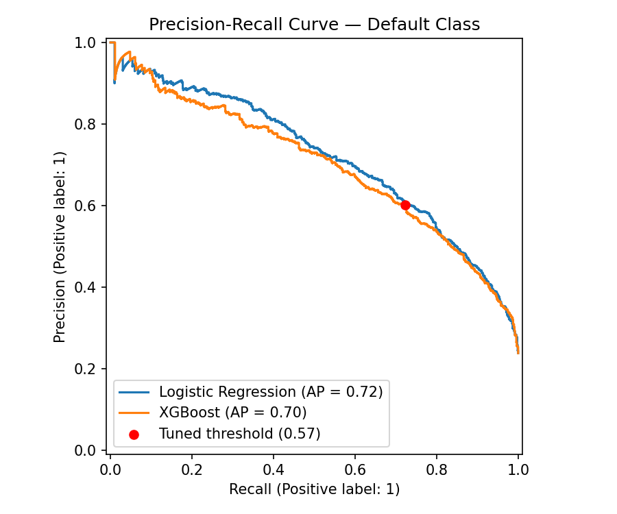
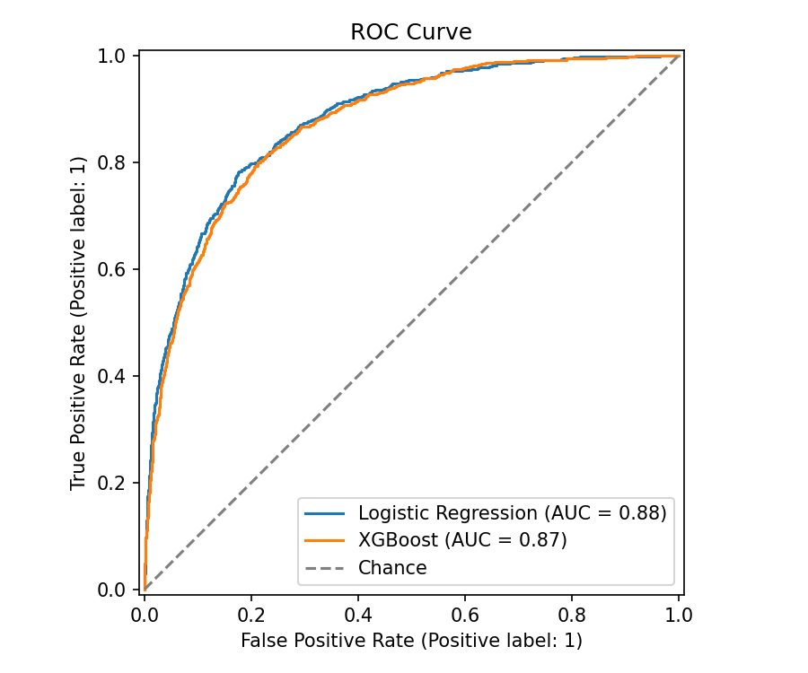
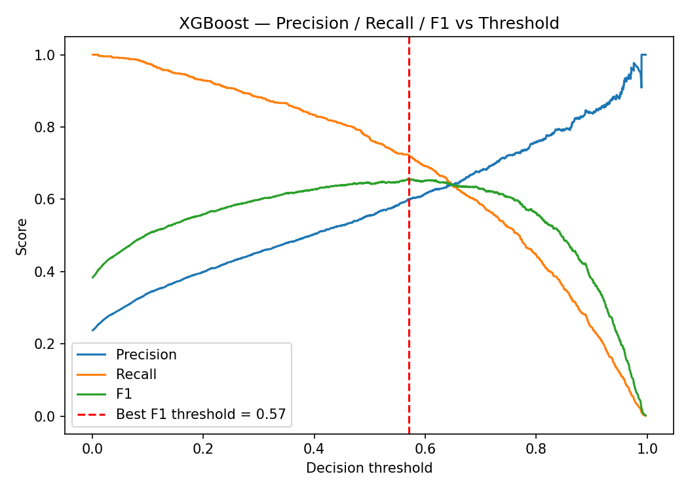
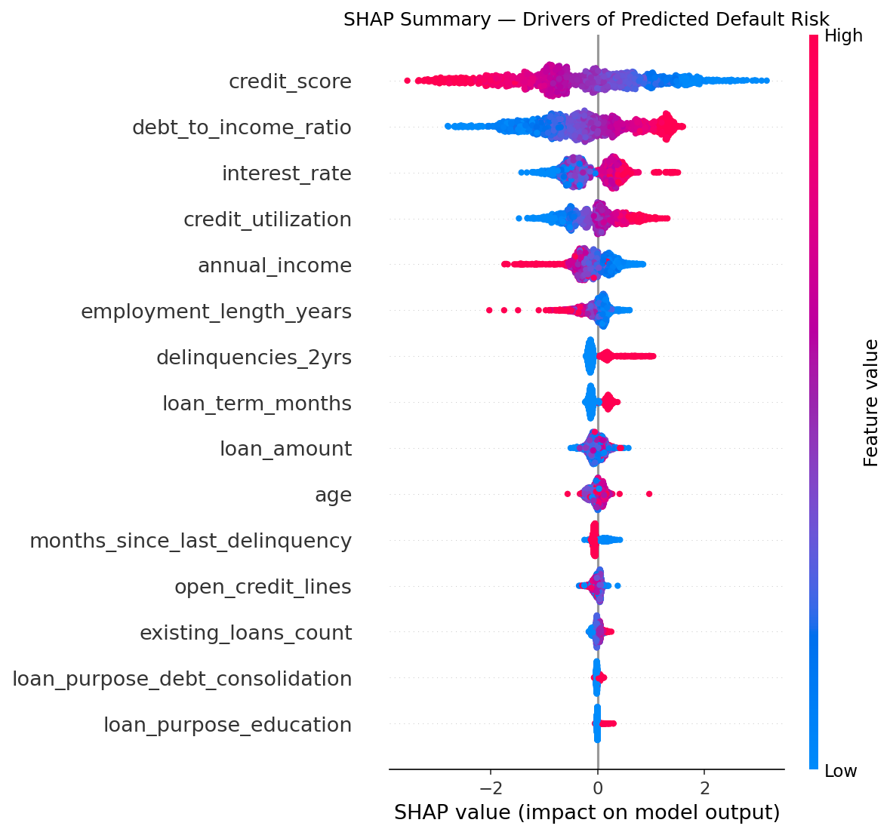
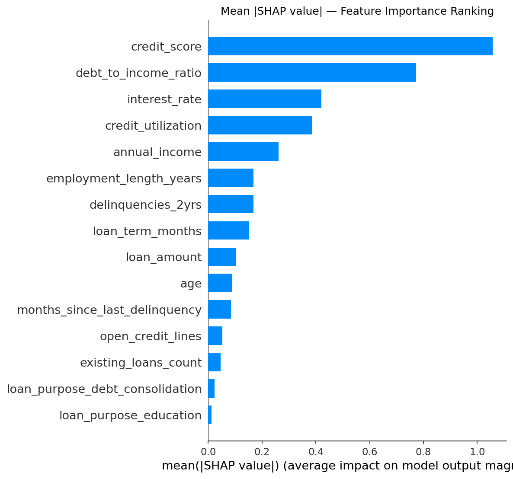
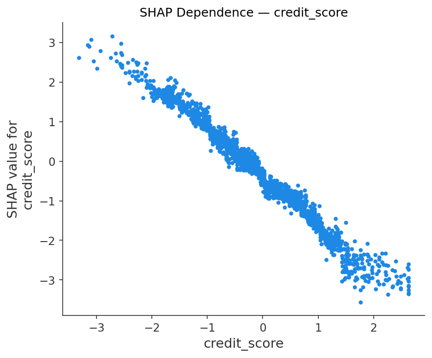
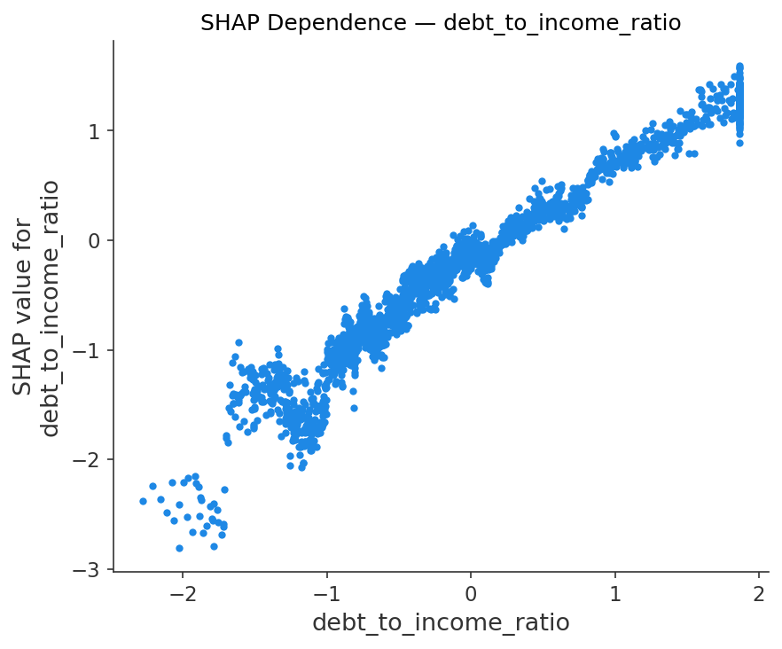
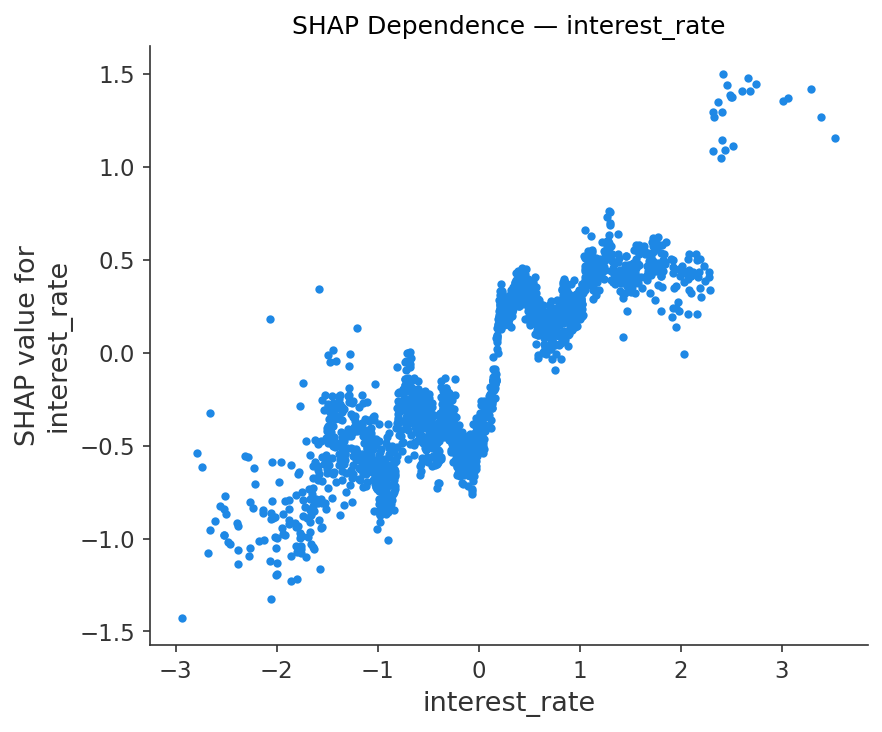
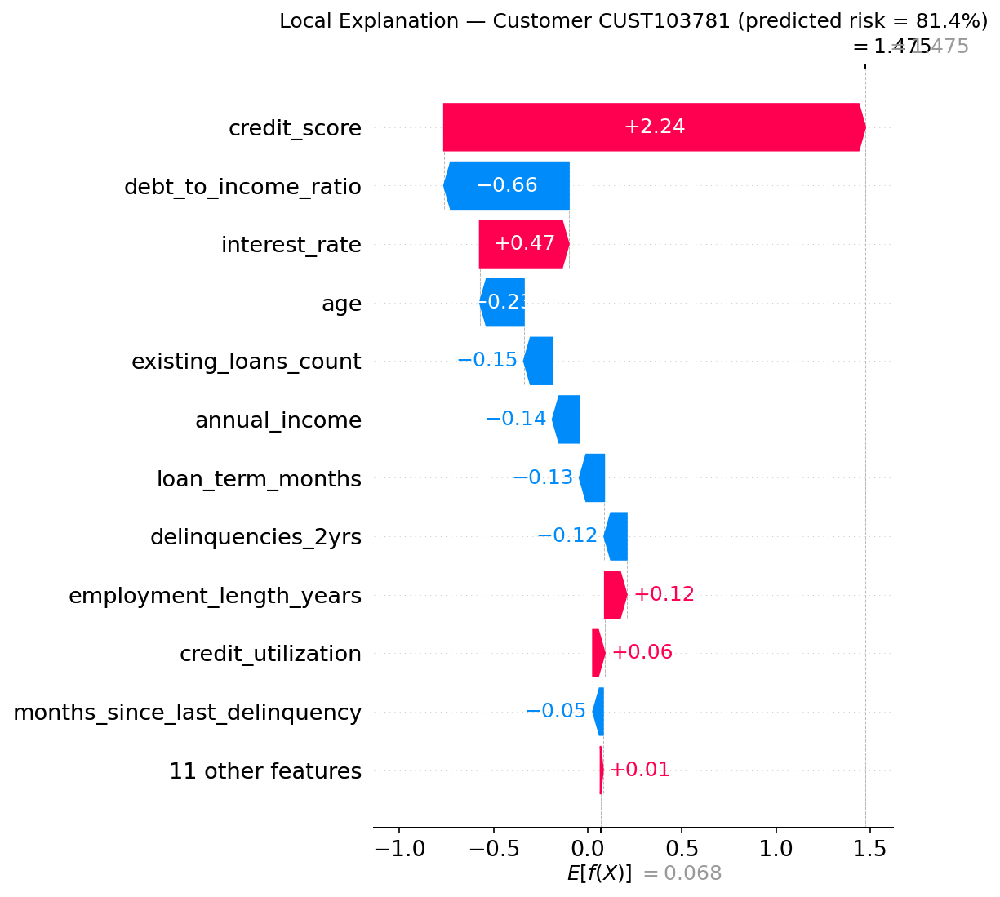

# Risk Modelling: Predicting Loan Defaulters

A case study in credit risk modeling for retail banking — building a model that flags customers likely to default on a loan, evaluating it with the metrics that actually matter for an imbalanced risk problem (precision, recall, F1), and explaining *why* the model flags each customer using SHAP.

> **Data note:** this project uses a synthetic loan portfolio of 15,000 records (`data/loan_data.csv`), generated in `src/generate_data.py` to mimic real retail-lending bureau and application data (credit score, debt-to-income, utilization, delinquencies, etc.), with a simulated, noisy default outcome. No real customer or bank data is used anywhere in this repository.

## Business problem

A lender wants to identify, at the time of application, which customers are likely to default so it can price risk appropriately, request additional collateral or a co-signer, or decline the highest-risk applications. Roughly 24% of loans in this portfolio default — a meaningful class imbalance that makes plain accuracy a misleading metric (a model that predicts "no default" for every applicant would already score ~76% accuracy while catching zero risk). The model instead needs to be judged on how well it separates the two classes, and on the tradeoff between catching real defaulters (recall) and not raising too many false alarms on good customers (precision).

## Project structure

```
Risk modelling/
├── README.md                              <- this file
├── requirements.txt
├── data/
│   └── loan_data.csv                      <- synthetic loan portfolio (15,000 rows)
├── src/
│   ├── generate_data.py                   <- synthetic data generator
│   ├── train_model.py                     <- preprocessing, training, evaluation, figure export
│   └── explain_shap.py                    <- SHAP explainability artifacts
├── notebooks/
│   └── risk_modelling_case_study.ipynb    <- full, executed walkthrough (EDA -> model -> SHAP)
├── models/
│   └── best_model.joblib                  <- trained pipeline (preprocessing + XGBoost)
└── reports/
    ├── metrics.json                       <- precision / recall / F1 / ROC-AUC / PR-AUC
    └── figures/                           <- confusion matrix, PR/ROC curves, SHAP plots
```

## How to reproduce

```bash
pip install -r requirements.txt
python src/generate_data.py     # writes data/loan_data.csv
python src/train_model.py       # trains models, writes reports/metrics.json and reports/figures/
python src/explain_shap.py      # writes SHAP figures to reports/figures/
```

Or open `notebooks/risk_modelling_case_study.ipynb` for the full narrated walkthrough — it is already executed and saved with all outputs, so it can be read top-to-bottom on GitHub without re-running anything.

## Data

Each row is one loan application with credit-bureau attributes (credit score, credit utilization, delinquencies in the last 2 years, months since last delinquency, open credit lines), applicant attributes (age, annual income, employment length, home ownership), and loan attributes (amount, term, interest rate, purpose, debt-to-income ratio). The target, `default`, is a simulated binary outcome whose probability is a non-linear, noisy function of these features — weighted so that low credit score, high debt-to-income, high utilization, and prior delinquencies increase default risk, matching real-world credit risk relationships.

## Modeling approach

Two models were trained on a stratified 75/25 train/test split (default rate preserved in both):

- **Logistic Regression** (baseline) — standardized numeric features, one-hot encoded categoricals, `class_weight="balanced"` to counter the class imbalance. Kept as an interpretable benchmark, which risk teams often retain in production alongside a more complex "challenger" model for governance reasons.
- **XGBoost** (primary model) — gradient-boosted trees with `scale_pos_weight` tuned to the train-set class ratio, shallow trees (`max_depth=4`) and subsampling to limit overfitting on the moderate-sized dataset.

## Results: precision, recall, F1

| Model | Threshold | Precision (default) | Recall (default) | F1 (default) | ROC-AUC | PR-AUC |
|---|---|---|---|---|---|---|
| Logistic Regression | 0.50 | 0.549 | 0.798 | 0.651 | 0.879 | 0.719 |
| XGBoost | 0.50 | 0.555 | 0.768 | 0.644 | 0.873 | 0.699 |
| **XGBoost (tuned)** | **0.57** | **0.601** | **0.723** | **0.656** | 0.873 | 0.699 |

*(Full report, including per-class precision/recall/F1 and support, is in `reports/metrics.json`.)*

At the default 0.5 cutoff, the model catches roughly 3 out of 4 actual defaulters but only about half of the customers it flags actually go on to default — a lot of false alarms per true catch. Scanning thresholds and picking the one that maximizes F1 on the default class (0.57) trades some recall for materially better precision, which is a reasonable starting point before a real risk team overlays the actual cost of a missed default versus the cost of declining or escalating a good customer. **Where to sit on this curve is a business decision, not a modeling one** — a collections-cost-sensitive lender may prefer high recall even at low precision; a customer-experience-sensitive lender may prefer the opposite.









## Explainability with SHAP

A precision/recall number tells us how well the model separates defaulters from non-defaulters; it doesn't tell us *why* a given customer was flagged. In consumer lending that "why" matters — for underwriters who need to trust and act on the score, and for fair-lending / adverse-action explainability requirements. [SHAP](https://github.com/shap/shap) (SHapley Additive exPlanations) attributes each prediction to its input features using game-theoretic Shapley values.



Each dot is one customer; position on the x-axis is that feature's contribution to the predicted default risk for that customer, color is the feature's actual value (red = high, blue = low). Low credit scores, high debt-to-income ratio, high interest rate (itself a proxy for priced-in risk) and high credit utilization are consistently the strongest and most intuitive drivers of predicted default — exactly what a credit officer would expect, which is a useful sanity check that the model has learned sensible signal rather than spurious correlations.



Dependence plots for the top three global drivers show the shape of each relationship individually:





And a local (per-customer) explanation, the kind that would support an underwriting decision or risk memo for one specific applicant:



## Business takeaways

Logistic Regression and XGBoost perform similarly here on ROC-AUC (~0.87–0.88), which suggests the risk relationships in this data are fairly monotonic; in practice, gradient-boosted trees tend to pull further ahead when there are real feature interactions, but keeping an interpretable linear model as a benchmark is still good governance practice for regulated credit decisions. SHAP confirms the model is keying off sensible, explainable risk signal — credit score, debt-to-income, utilization and risk-based pricing dominate — which supports both underwriting-team trust and fair-lending explainability requirements. For a production version, the natural next steps would be probability calibration (e.g. Platt scaling) if the score feeds a pricing engine that assumes calibrated probabilities, disparate-impact / fairness testing across protected classes, temporal (out-of-time) validation instead of a random split since credit risk drifts with macro conditions, and ongoing population/feature drift monitoring.

## Disclaimer

This is a portfolio / learning project built on synthetic data for demonstration purposes. It is not a production credit risk model and should not be used to make real lending decisions.
